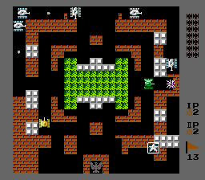

# Task 2 (3.0 points): Adversarial Search

**Description:** Tank Battle Game  
**Source pages:** 2-4 of the assignment PDF

## Description

- The game is designed as a turn-based game. During each game cycle, players take actions and the game state is updated accordingly.
- Each tank can move one cell per turn (UP, DOWN, LEFT, RIGHT). When a tank fires a bullet, the bullet travels at a speed of 3 cells per game cycle in the direction in which the tank is facing.
- The bullet movement is processed cell by cell. For each game cycle, the bullet moves up to three cells, and a collision check is performed after each cell movement. If the bullet encounters a wall, tank, or base, the corresponding collision event is triggered immediately. A bullet stops immediately after hitting an entity.
- Each game entity has a predefined amount of health as in the table.

| Entity | Initial HP | Damage per Hit |
|---|---:|---:|
| Tank | 6 | 1 |
| Base | 9 | 1 |
| Wall | 3 | 1 |

- A tank entity has 06 actions, including `MOVE_UP`, `MOVE_DOWN`, `MOVE_LEFT`, `MOVE_RIGHT`, `FIRE`, `STAY`.
- The game ends when either a base or a tank is destroyed. The player whose tank and/or base remains operational is declared the winner.
- Students are required to apply adversarial search algorithms introduced in Lecture 07, such as Minimax Search, Alpha-Beta Pruning, and Heuristic Minimax Search, to control the tank.

### Game reference image

Reference URL shown in the assignment: <https://www.hardcoregaming101.net/tank-battalion-battle-city/>

## Requirements

### 1. (1.0 point)

Formulate the given problem as a Zero-Sum Game and introduce its relevant components, including the game state, players, actions, transition function, terminal states, and utility function. Discuss how adversarial search algorithms, such as Minimax Search, Alpha-Beta Pruning, and Heuristic Minimax Search, can be applied to control the tanks.

### 2. (1.5 points)

Implement an algorithm to control the tanks in the game. Students may apply various optimization techniques to ensure that the tanks operates efficiently and the game runs in real time. Set up experiments to compare the computational time and search performance of the following four configurations:

1. Minimax Search
2. Alpha-Beta Search
3. Heuristic Minimax Search
4. Heuristic Minimax Search with Alpha-Beta Pruning

The experiments should use the same game scenarios and search conditions where applicable to ensure a fair comparison. Relevant metrics may include execution time, number of explored game states, search depth, and other appropriate performance measures.

### 3. (0.5 point)

Implement a graphical user interface using the PyGame library to operate the game. The system should provide a mechanism for importing and integrating algorithms developed by other student groups, allowing different algorithm implementations to compete against each other under the same game environment.

## Notice

- Recommended editor: Visual Studio Code.
- The project must be designed and implemented following Object-Oriented Programming principles.
- The evaluation configurations: macOS 13.7.8 (Ventura) with an Intel Core i5 processor.
