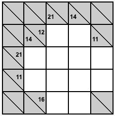
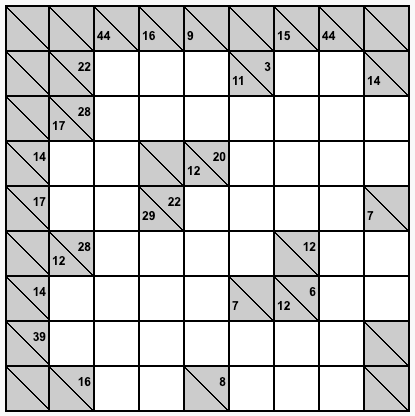

# Task 3 (3.0 points): Constraint Satisfaction Problems

**Description:** Kakuro  
**Source pages:** 4-6 of the assignment PDF

## Description

- Students are expected to familiarize themselves with the rules and gameplay of Kakuro by referring to the Kakuro article on Wikipedia: <https://en.wikipedia.org/wiki/Kakuro>.
- Given the example Kakuro game board shown below, students are required to formulate the game as a Constraint Satisfaction Problem (CSP) by identifying the variables, their corresponding domains, and the constraints governing the puzzle.

### Example Kakuro board

- Students should then develop a solver that combines constraint propagation techniques with Backtracking Search to find a valid solution. The implementation should incorporate appropriate heuristic techniques introduced in Lecture 08 to improve the efficiency of the search process.

## Requirements

### 1. (1.0 point)

Formulate the given problem correctly as a Constraint Satisfaction Problem (CSP), clearly identifying and explaining the relevant components, including variables, domains, and constraints. Describe and justify the algorithms and techniques applied in the project.

### 2. (1.0 point)

Implement a solver capable of finding a valid solution to the given problem. Demonstrate and evaluate the solver’s correctness, stability, and effectiveness by applying it to the more complex test case provided below.

### More complex test case

### 3. (1.0 point)

Implement a user interface (UI) for the game that clearly visualizes the domains of variables, the constraint propagation process, and the Backtracking Search process.

## Notice

- Recommended editor: Visual Studio Code.
- The project must be designed and implemented following Object-Oriented Programming principles.
- The evaluation configurations: macOS 13.7.8 (Ventura) with an Intel Core i5 processor.
